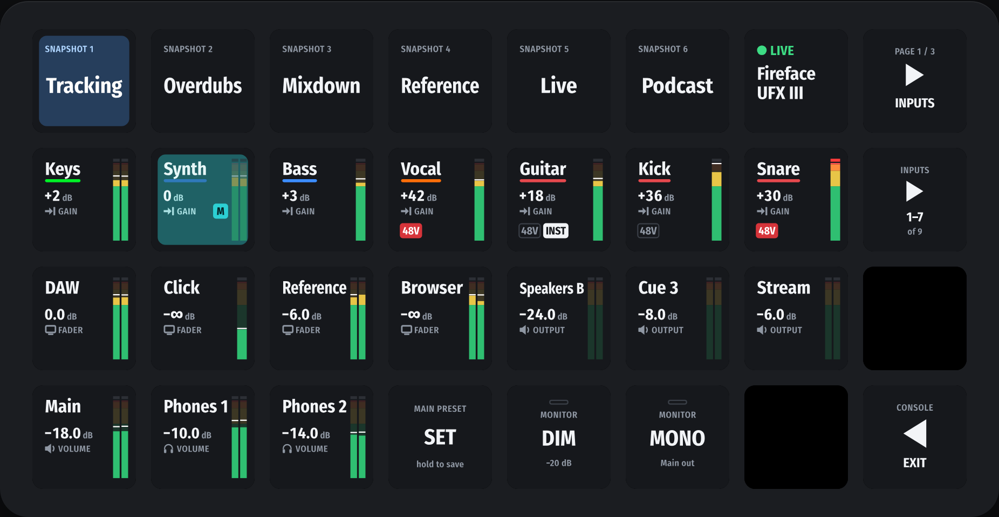
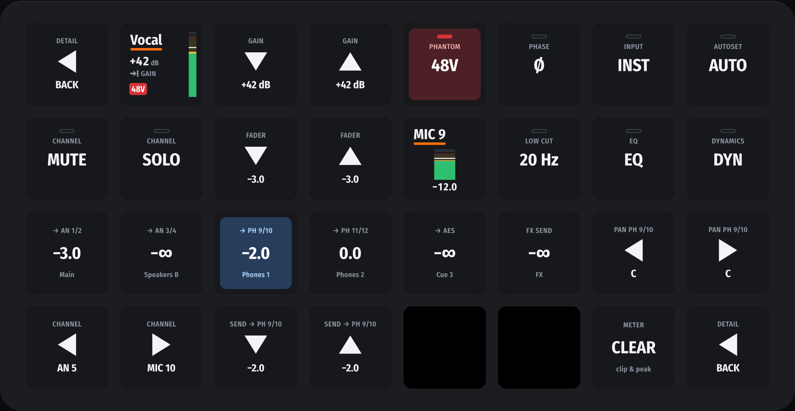
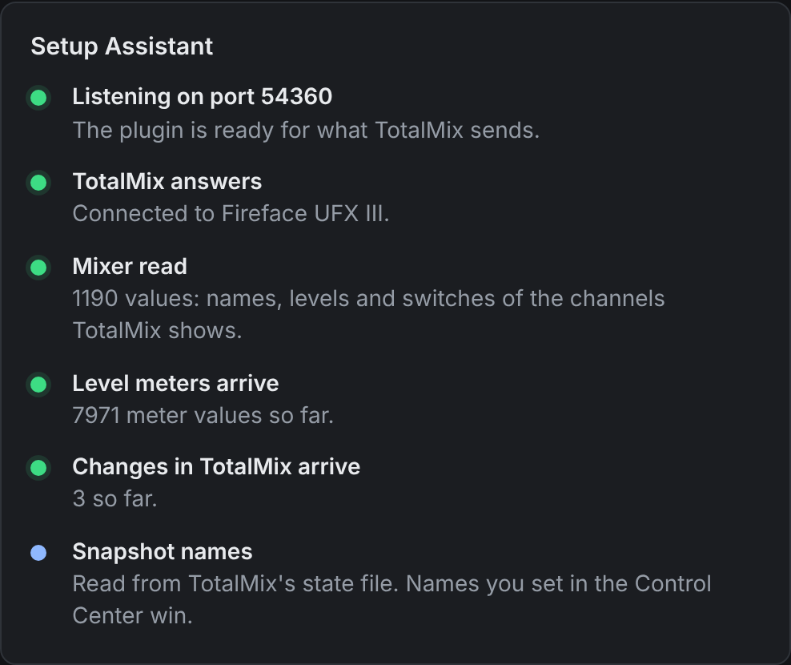
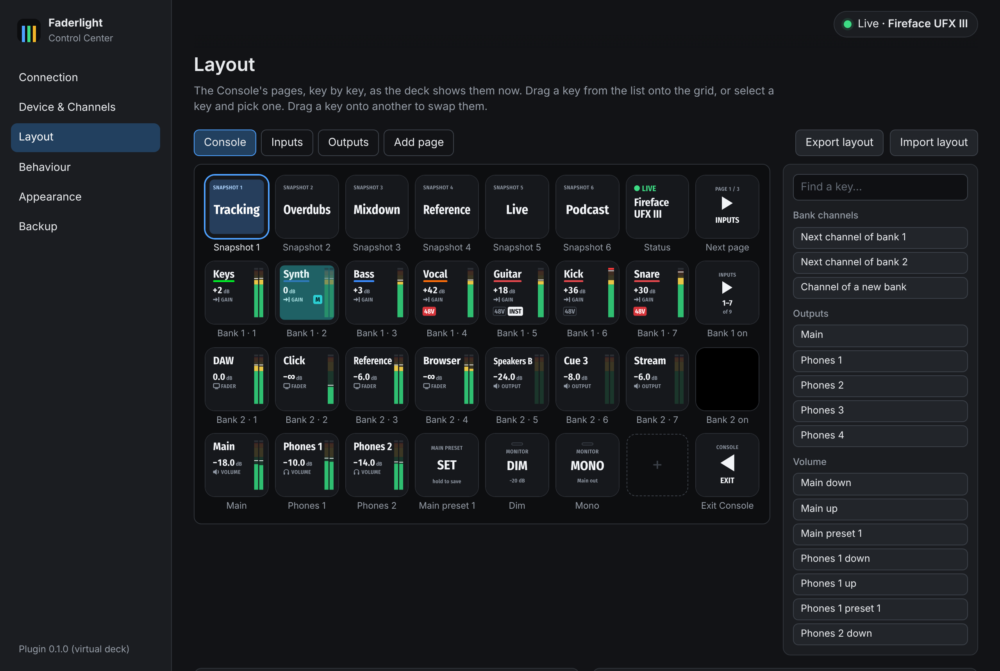

# Faderlight

A Stream Deck plugin for RME audio interfaces: the TotalMix FX mixer on a Stream Deck XL.
Channel names in their TotalMix colours, gain and levels in dB, live meters, mute and solo,
Main and Phones, Dim, Mono and snapshots, and every change made in TotalMix on the keys at
once.



**[Website](https://ratio32.com/faderlight)** ·
**[Download](https://github.com/akorobko/faderlight/releases/latest)** ·
**[Setup guide](docs/setup.md)** · [Changelog](CHANGELOG.md)

## What it does

- **Channel keys.** The name on its TotalMix colour, the gain or fader in dB, 48V and Inst
  badges, and a stereo meter whose clip mark stays until cleared. A tap mutes, and the key
  follows mutes made in TotalMix.
- **Channel Detail.** Hold a channel key and the whole deck becomes that channel: gain in 1 dB
  steps, 48V, phase, Inst, AutoSet, mute, solo, fader, low cut, EQ, dynamics, and its sends to
  Main, the Phones mixes and the FX.
- **Monitoring.** Main and Phones volume in 0.5 dB steps that speed up while held, Dim, Mono,
  Talkback, Speaker B, level presets saved with a long press, and snapshots 1 to 8.
- **The Console.** A ready-made XL profile with snapshots, the Status key, two banks of seven
  channel strips and the monitoring row, plus Inputs and Outputs pages. Each key can also go
  on any profile of your own.
- **The Control Center.** Settings in your browser, opened from the Status key: a Setup
  Assistant that checks TotalMix's OSC settings by what actually arrives, a packet log, your
  own channel names and colours, a layout builder and a settings backup. It runs inside the
  plugin and needs no account or internet connection.



| Setup Assistant                                                                | Layout builder                                                              |
| ------------------------------------------------------------------------------ | --------------------------------------------------------------------------- |
|  |  |

## Requirements

| What            | Version                                                                                                   |
| --------------- | --------------------------------------------------------------------------------------------------------- |
| Stream Deck     | XL for the Console layout. The single keys should work on other models with keys; only the XL is tested.  |
| Stream Deck app | 7.1 or later                                                                                              |
| Computer        | macOS 13 or later, or Windows 10 or later. Tested on macOS; Windows runs the automated tests only so far. |
| TotalMix FX     | 2.1 or later, for Global OSC. As of November 2026, 2.1 is a beta from RME's forum.                        |
| Interface       | An RME interface that TotalMix FX 2.1 supports. Tested with a Fireface UFX III.                           |

## Install

1. Download `Faderlight-<version>.streamDeckPlugin` from the
   [latest release](https://github.com/akorobko/faderlight/releases/latest) and double-click it.
2. Turn on OSC in TotalMix FX: [the setup guide](docs/setup.md) has every setting.
3. Switch the XL to the **Faderlight Console** profile. The Status key shows your interface
   with a green LIVE.

## Development

Requires Node.js 24 (see `.nvmrc`). No interface needed: a simulator stands in for TotalMix FX,
and a virtual deck draws the keys in a browser.

```sh
npm ci
npm run check            # vendor guard, format, lint, typecheck, tests
npm run sim              # fake TotalMix FX on ports 7002/9002 (packages/simulator/README.md)
npm run deck             # the keys on a web page, against the simulator (tools/virtual-deck)
npm run e2e              # browser tests of the virtual deck, screenshots in renders/
npm run render:goldens   # key images and renders/contact-sheet.png (packages/render/README.md)
npm run plugin:build     # the Stream Deck plugin (packages/plugin/README.md)
npm run plugin:pack      # the release file dist/Faderlight-<version>.streamDeckPlugin
npm run screenshots      # the pictures in docs/images/
```

| Path                      | Contents                                       |
| ------------------------- | ---------------------------------------------- |
| `packages/osc`            | OSC codec and UDP transport                    |
| `packages/totalmix`       | TotalMix FX Global OSC adaptor                 |
| `packages/model`          | Mixer model, device profiles, meters           |
| `packages/render`         | Key renderers (SVG)                            |
| `packages/deck`           | Deck runtime: settings, gestures, layouts      |
| `packages/plugin`         | The Stream Deck plugin (SDK wiring, manifest)  |
| `packages/control-center` | Control Center: settings page and its server   |
| `packages/simulator`      | Fake TotalMix FX for hardware-free development |
| `tools/`                  | Developer tools (capture, virtual deck)        |
| `docs/design/`            | Design documents, starting with the README     |
| `docs/protocol/`          | Global OSC as TotalMix actually sends it       |

Agent and contributor rules are in [AGENTS.md](AGENTS.md). RME reference documents are not in
the repository; `scripts/fetch-vendor.sh` downloads them into `docs/vendor/`.

## Trademarks

Faderlight is made by [ratio32](https://ratio32.com) and is not affiliated with RME or Elgato.
"RME", "TotalMix", "Fireface", "Elgato" and "Stream Deck" are trademarks of their respective
owners.
