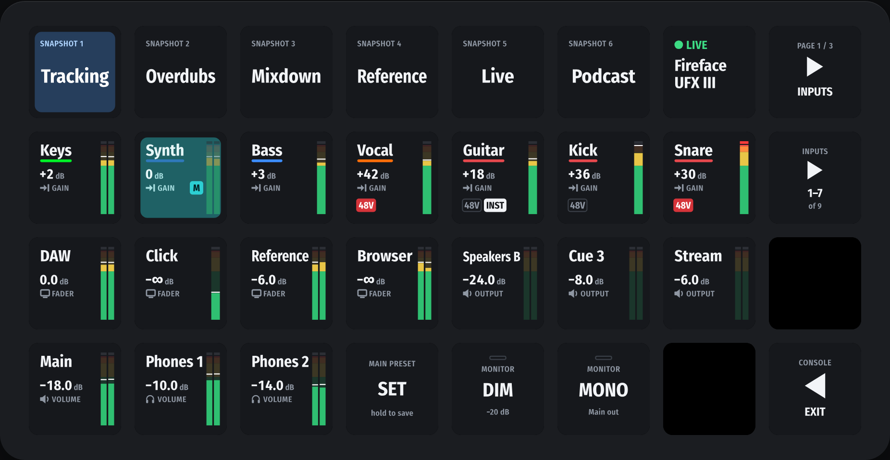
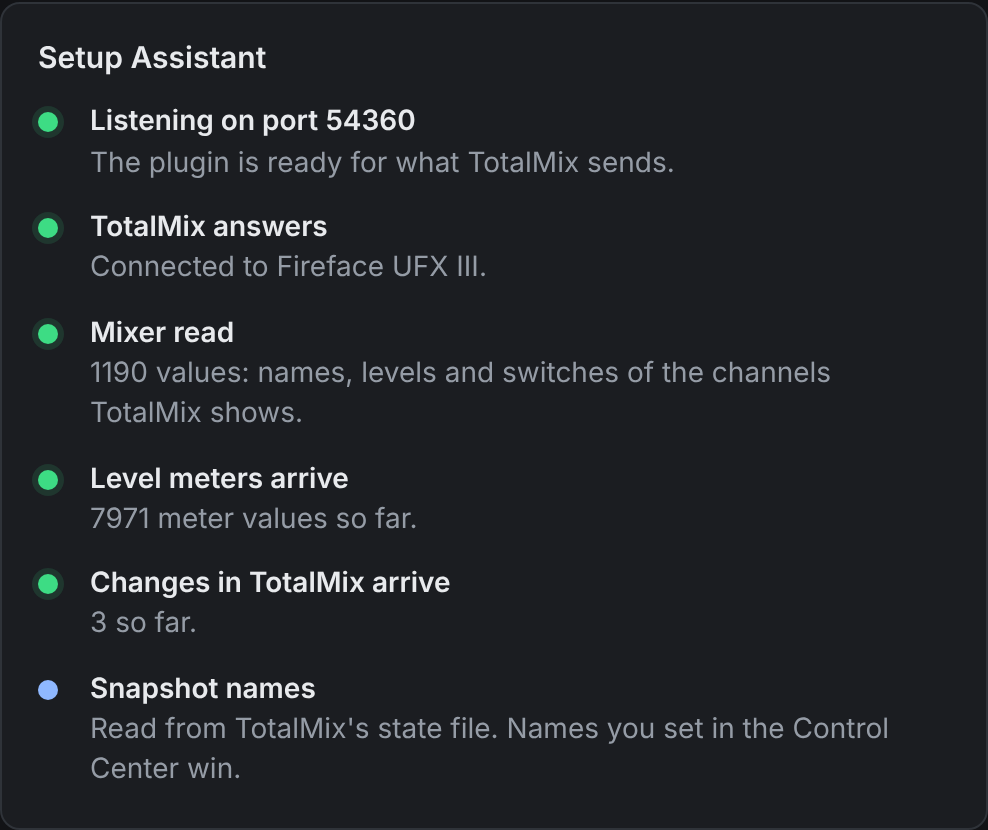

# Setting up Faderlight

About five minutes. TotalMix FX runs on the same computer as the Stream Deck app (another
computer on the network works too: see [TotalMix on another computer](#totalmix-on-another-computer)).

## 1. TotalMix FX 2.1 or later

Faderlight speaks Global OSC, the remote protocol that arrived in TotalMix FX 2.1. To check
yours, open **Options → Settings → OSC**: if the mode list (Compatibility) only offers
"TotalMix 1.90" and "TotalMix 1.96", TotalMix is older than 2.1.

As of November 2026, TotalMix FX 2.1 is a beta posted in RME's user forum; RME's downloads
page still offers 2.0. Save your workspace (**File → Save Workspace As**) before you update.

## 2. Install Faderlight

Download `Faderlight-<version>.streamDeckPlugin` from the
[latest release](https://github.com/akorobko/faderlight/releases/latest) and double-click it.
The Stream Deck app (7.1 or later) installs the plugin and its **Faderlight Console** profile
for the Stream Deck XL. A newer version installs over an older one and keeps your settings.

## 3. Turn on OSC in TotalMix

1. Menu **Options**: tick **Enable OSC Control**.
2. **Options → Settings → OSC** tab. Pick a free **Remote Controller** slot (for example 2, if
   slot 1 is used by another controller) and set:

   | Setting                                                          | Value                                 |
   | ---------------------------------------------------------------- | ------------------------------------- |
   | In Use                                                           | ticked                                |
   | Port incoming                                                    | `7002`                                |
   | Port outgoing                                                    | `9002`                                |
   | Remote Controller Address (IP or Host Name)                      | `127.0.0.1`, not empty, not localhost |
   | Compatibility (Mode)                                             | Global OSC                            |
   | Details: Send changes, Send status, Re-send received             | ticked                                |
   | Details: Send all data on start, Re-send if different            | not ticked                            |
   | Details: Send faders in linear scale, Receive to hidden channels | not ticked                            |
   | Send Level Data (and Send Peak Level, if your version has it)    | ticked, for the meters                |

   Leave the bandwidth limit and the **Found Remote Services** list as they are. Do not use
   `localhost` as the address: it can resolve to an IPv6 address the plugin does not listen
   on. On Windows, TotalMix sends nothing back while the address is empty.

3. Quit anything else that listens on UDP port 9002, such as Bitfocus Companion or another
   OSC plugin, or choose other ports (see [Other ports](#other-ports)).

<!-- A screenshot of TotalMix's OSC settings goes here: docs/images/totalmix-osc.png. -->

## 4. Open the Console

In the Stream Deck app, switch the XL to the **Faderlight Console** profile. Or drag
Faderlight's **Open Console** action onto a key of any profile and press it; **Exit** on the
Console goes back.

## 5. Check the connection

The Status key (top row, seventh key) shows your interface and a green **LIVE**. Tap it: the
Control Center opens in your browser on its Connection page. Its Setup Assistant checks each
TotalMix setting by what actually arrives, and says what to change when a check stays red.

## Other ports

The Control Center's Connection page sets where TotalMix runs and both ports. TotalMix's
**Port incoming** is where the plugin sends, its **Port outgoing** is where the plugin
listens. Change them on both sides.

## TotalMix on another computer

Set **Computer running TotalMix** in the Control Center to that computer's IP address, and
TotalMix's **Remote Controller Address** to the IP address of the computer with the Stream
Deck. Both computers need UDP on the two ports open in their firewalls. This has not been
tried with real hardware yet; please report how it goes.

## When something does not work

| What you see                                 | What to change                                                                                                        |
| -------------------------------------------- | --------------------------------------------------------------------------------------------------------------------- |
| The Status key says offline                  | TotalMix runs, Enable OSC Control is ticked, the slot is In Use with Mode Global OSC, and the ports are 7002 and 9002 |
| Keys don't follow changes made in TotalMix   | Details: tick Send changes and Send status                                                                            |
| Meters don't move                            | Tick Send Level Data                                                                                                  |
| "Port 9002 is in use" in the Setup Assistant | Quit the other app on that port, or choose another port on both sides                                                 |
| Snapshot keys show numbers instead of names  | See below                                                                                                             |
| Nothing arrives on Windows                   | Fill in Remote Controller Address with `127.0.0.1`                                                                    |

Global OSC does not send snapshot names. On macOS, Faderlight reads them from the file
TotalMix writes when it quits, so a renamed snapshot shows after TotalMix has quit once. Where
TotalMix keeps that file on Windows is not known yet. Either way, names set in the Control
Center (**Device & Channels**) win.

Still stuck? Open an [issue](https://github.com/akorobko/faderlight/issues) with what the
Setup Assistant shows.
